<!-- Cards in ./cards are self-contained SVGs: each carries its own backgrounds,
     fonts, CSS keyframes and BOTH palettes, and rotates dark -> light -> dark
     on a 60s loop, so both themes show without the reader changing anything.
     Re-render with:  pip install fonttools pillow && python scripts/build_cards.py
     Contribution graph: python scripts/fetch_contributions.py, then re-render
     (or let .github/workflows/cards.yml do it daily), then add the line
      
     right after the hero link below.
     Keep this block free of blank lines, and keep the cards in each row on one
     line with no spaces between them, or the 33.333% thirds will wrap. -->

<a href="https://github.com/techakash32"></a> 
 
 
<a href="https://github.com/techakash32?tab=repositories"></a><a href="https://github.com/techakash32?tab=repositories"></a><a href="https://github.com/techakash32?tab=repositories"></a> 
<a href="https://github.com/techakash32?tab=repositories"></a><a href="https://github.com/techakash32?tab=repositories"></a><a href="https://github.com/techakash32?tab=repositories"></a> 
 

Football &nbsp;·&nbsp; Travel &nbsp;·&nbsp; Cars &nbsp;·&nbsp; Anime

<a href="https://github.com/techakash32">github</a> &nbsp;/&nbsp; <a href="https://www.linkedin.com/in/akash-nagar-b06b20244/">linkedin</a> &nbsp;/&nbsp; <a href="mailto:akashnagar97846@gmail.com">email</a>

